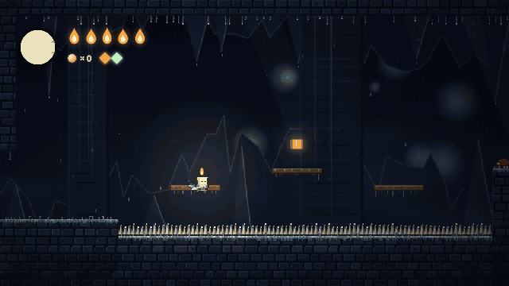
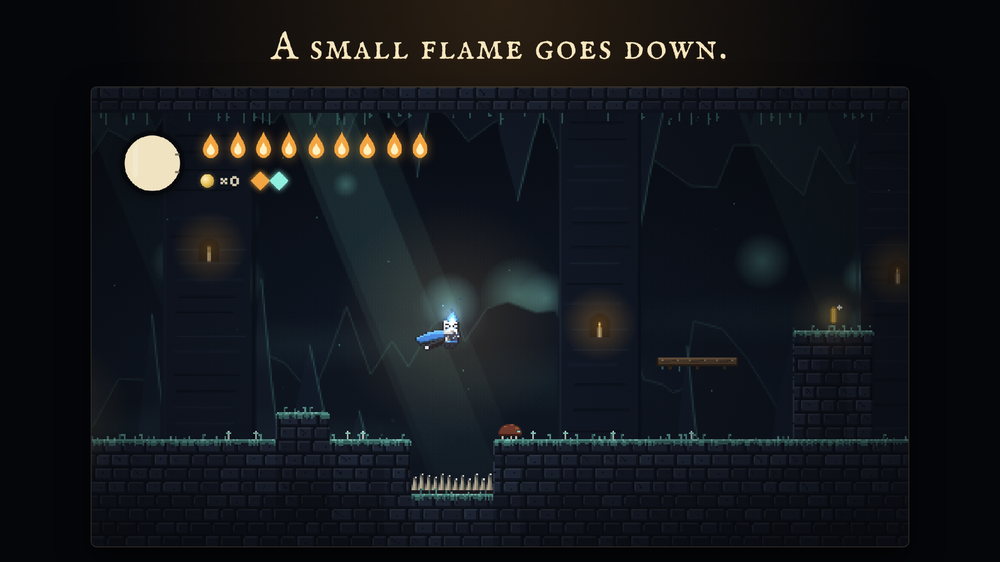
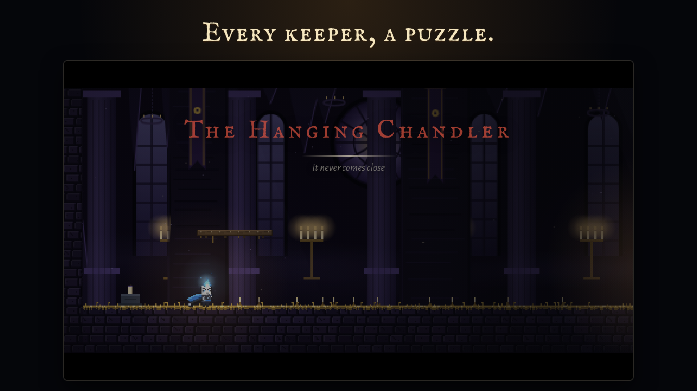
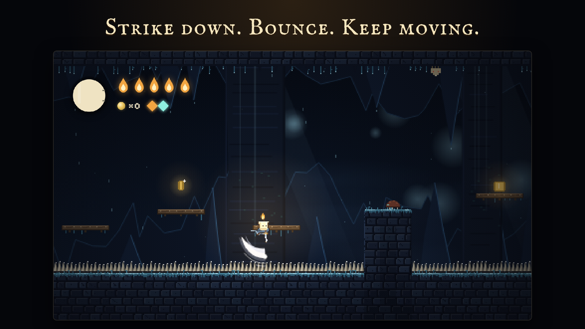
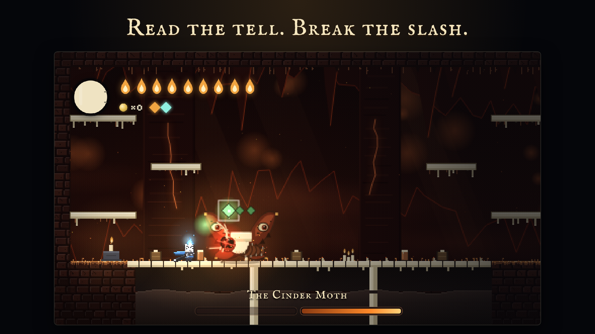
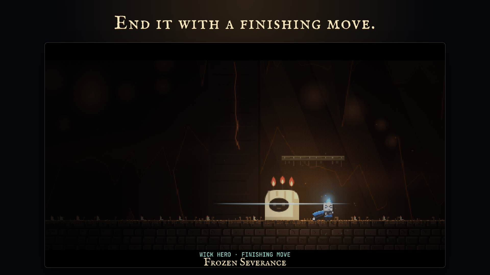
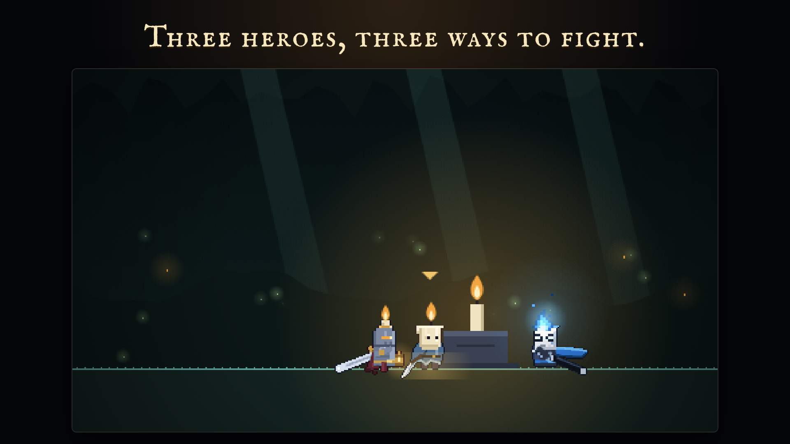
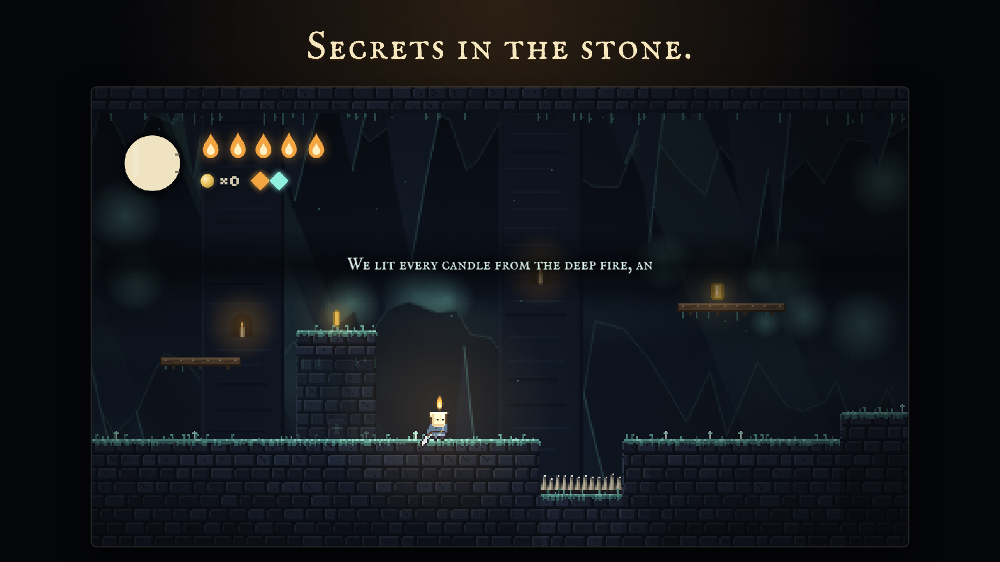
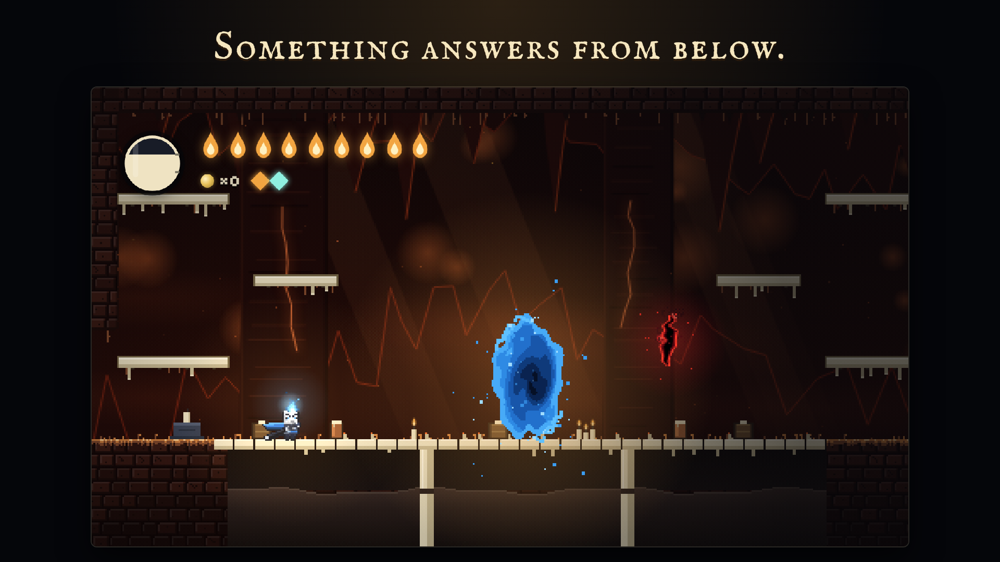
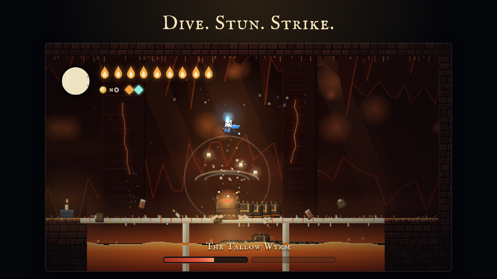

<p align="center">
  <a href="https://shibainu0817.github.io/wickfall/"></a>
</p>

<h1 align="center">Wickfall</h1>
<p align="center"><i>Every flame goes out. Not yours.</i></p>

<p align="center">
  <a href="https://shibainu0817.github.io/wickfall/"></a>
  &nbsp;
  <a href="media/trailer.mp4"></a>
</p>

A small candle goes down into the dark, where every flame is going out.
Wickfall is a short, candle-lit platformer: keepers to put to rest, three heroes, hidden alcoves, a boss rush and something waiting below.
It runs in the browser on desktop and phone, with no download, no account and no server. Progress stays on your device.

<table>
  <tr>
    <td></td>
    <td></td>
    <td></td>
  </tr>
  <tr>
    <td></td>
    <td></td>
    <td></td>
  </tr>

https://github.com/user-attachments/assets/08b3d84f-7bf7-4e06-a8b8-6914a9d486b8


  <tr>
    <td></td>
    <td></td>
    <td></td>
  </tr>
</table>

## Controls

| | Keyboard | Gamepad | Phone |
|---|---|---|---|
| Move | ← → or A D | left stick or d-pad | left half of the screen |
| Jump | Space or Z (hold to jump higher) | A / Cross | Jump |
| Slash | X or J (hold ↑ or ↓ to aim) | X / Square | Slash (swipe on it to aim) |
| Dash | Shift, C or K | any shoulder button | Dash |
| Focus | hold F | hold B / Circle | Focus |
| Skill | E or L, once learned | Y / Triangle | Skill |
| Pause | P or Esc (M toggles sound) | Start | Pause |

---

## Folders

```
wickfall/
├── src/                     what you edit
│   ├── head.html            the document head for deploys: phone viewport, home-screen tags, a small reset
│   ├── page.html            the game page: title, fonts, HUD and overlay markup (@@STYLE@@ and @@SCRIPT@@ are filled in by the build)
│   ├── style.css            every style rule
│   ├── js/                  the game script, split into numbered parts joined in order (one shared scope)
│   ├── audio/               the music tracks; sfx/ holds the slash sounds (embedded into the page by the build)
│   ├── labs/                Boss Lab and Black Wick Skill Lab pages (they embed the game as lab.html)
│   ├── pwa/                 home-screen manifest and icons
│   └── lab-head.html        the three lines that turn the game into lab.html
├── dist/                    what you deploy (generated; do not edit)
├── build/                   artifact.html: the game page without head.html, for claude.ai (generated)
├── .claude/skills/          project skills for Claude: workflow, adding content (heroes, enemies, bosses, stages), feel and polish
├── media/                   trailer, teaser, screenshots and the link-preview image
├── site.json                version, public address, title and slogan (fills the version label and link-preview tags)
├── CHANGELOG.md             what changed in each version
├── .github/workflows/       GitHub Pages deploy
├── tests/                   regression tests (fast stub tests, plus browser tests in tests/browser)
└── tools/
    ├── build.py             src/ → dist/
    ├── test.sh              build and run the tests
    ├── capture/             scripted recording of the trailer and screenshots
    └── music/               the scripts that cut and level the music from the source tracks
```

## Build, test, deploy

```
python3 tools/build.py                          # writes dist/; re-run after every change in src/
python3 -m http.server 8000 --directory dist    # play locally at http://localhost:8000
tools/test.sh                                   # stub tests, about a minute
tools/test.sh --all                             # plus the browser tests (needs Playwright and Chromium)
```

Every push to `main` builds the game and deploys `dist/` to GitHub Pages (`.github/workflows/pages.yml`).
To host it elsewhere, upload the contents of `dist/` together to any static host and serve it over http(s); opened from disk, the music is blocked.

### Releasing a patch

1. Bump `version` in `site.json` (it shows on the title and pause screens).
2. Add a line to [CHANGELOG.md](CHANGELOG.md).
3. Commit, tag and push: `git tag v0.1.1-beta && git push && git push --tags`.

Keep saves compatible: progress lives in players' browsers (`wf-` keys), so convert old saves if their shape changes.
